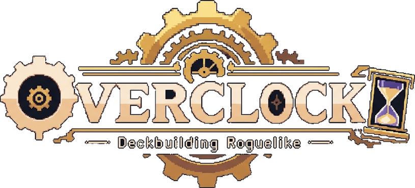

<p align="center"></p>

# 오버클록 (Overclock)

> 멈춰버린 세계의 시간을 다시 돌리기 위해, 마도공학 시계탑을 오른다.

**오버클록**은 웹 브라우저에서 플레이하는 **턴제 덱빌딩 로그라이크** 게임입니다.
태엽 부품과 증기 연동 장치가 된 카드를 조합해 연쇄 효과를 일으키고, 매번 새로 생성되는 시계탑을 오릅니다. 쓰러지면 처음부터 다시 시작합니다.

### ▶ [지금 플레이하기 — overclock-blush-theta.vercel.app](https://overclock-blush-theta.vercel.app)

설치 없이 브라우저에서 바로 플레이할 수 있습니다.

---

## 세계관

### 시계태엽과 마도공학 (Steampunk Fantasy)
기계와 마법이 정교하게 얽힌 세계입니다. 증기와 톱니바퀴, 그리고 마력이 하나의 동력으로 맞물려 돌아가던 이 세계는 어느 날 **모든 시간이 멈춰 버렸습니다.**

세계의 중심에 선 거대한 **마도공학 시계탑**. 그 꼭대기의 중추 태엽을 다시 감아야만 시간이 흐르기 시작합니다. 플레이어는 시계탑의 층을 하나씩 올라가며, 멈춘 시간 속에서 폭주하거나 고장 난 기계·마도 생명체와 맞서게 됩니다.

### 카드 = 태엽 부품
- 모든 카드는 **'태엽 부품'** 또는 **'증기 연동 장치'** 입니다.
- 덱은 플레이어가 조립하는 하나의 **기계 장치**이고, 카드를 추가·강화·제거하는 것은 장치를 개조하는 과정입니다.
- 카드를 서로 맞물려 사용할수록 태엽이 돌아가고, 일정 이상 회전하면 **강력한 연쇄 효과(시너지)** 가 발동합니다.

---

## 캐릭터

시작할 때 다섯 명 중 한 명을 고릅니다. 캐릭터마다 체력·고유 능력·시작 덱이 다르고,
**전투 보상에서 자신의 덱 유형에 어울리는 카드가 4배 더 잘 나옵니다** (보상 화면에 ★ 어울림 표시).

| 캐릭터 | 덱 유형 | 체력 | 고유 능력 | 대표 시작 카드 |
|--------|---------|------|-----------|----------------|
| 기관사 | 연사 (드로우·연타) | 70 | 태엽 장인 — 매 턴 회전 1로 시작 | 태엽 감기, 톱니 연사 |
| 보일러공 | 지속 피해 (화상·산성·감전) | 66 | 불씨 — 적에게 화상·산성·감전을 걸 때마다 +1 | 부지깽이 찌르기, 산성 플라스크, 끓는 배관 |
| 증기 포수 | 압력 (한방딜) | 72 | 축압 탱크 — 매 턴 압력 +3 | 계기 타격, 포탄 장전, 증기 대포 |
| 황동 수호자 | 방벽 (막고 반격) | 85 | 가시 외피 — 가시 3 | 가시 방패, 방패 강타 |
| 오버클러커 | 과열 | 64 | 냉각 코어 — 과열 한계 15, 과열이 오를 때마다 방어도 +2 | 점화 플러그, 과열 방출 |

## 핵심 게임 루프

```
런 시작 → 시계탑 층 지도에서 다음 방 선택 → 방 처리(전투/이벤트/상점/정비소)
        → 보상 획득(부품 카드·유물·톱니 화폐) → 장치(덱) 개조 → … → 구역 보스 처치 → 다음 구역
                                                                 ↘ 쓰러지면 런 종료
```

---

## 주요 시스템

### 1. 전투 (턴제 카드 배틀)
- 매 턴 **증기압(에너지)** 이 충전되고, 덱에서 카드를 드로우합니다.
- 카드는 증기압을 소모해 사용하며 공격·방어·버프/디버프 등의 효과를 냅니다.
- 적은 다음 행동을 **의도(Intent)** 로 미리 보여 주어 대응을 계획할 수 있습니다.
- 턴 종료 시 남은 손패는 버린 더미로, 드로우 더미가 비면 버린 더미를 섞어 다시 사용합니다.

### 2. 태엽 맞물림 (핵심 메커니즘)
세계관을 게임 규칙으로 옮긴 오버클록만의 시스템입니다. *(초안 — 플레이테스트하며 조정)*

| 요소 | 설명 |
|------|------|
| **회전(Turn)** | 한 턴에 카드를 사용할 때마다 태엽이 1칸 감깁니다. 회전 수에 따라 강해지는 카드가 있습니다. |
| **맞물림(Mesh)** | 특정 카드 직후에 사용하면 추가 효과가 발동합니다. 예: "직전에 사용한 카드가 *증기* 카드라면 피해 +4" |
| **연동(Link)** | 이번 턴에 같은 계열 카드를 연속으로 사용하면 연쇄 효과가 이어집니다. |
| **오버클록** | 증기압이 부족해도 **과열(Heat)** 을 쌓아 카드를 강행 사용할 수 있습니다. 과열이 한계를 넘으면 장치가 고장 나 패널티를 받습니다. — 게임 제목의 유래 |
| **태엽 장력** | 한 턴에 카드 효과로 뽑을 수 있는 카드는 최대 20장입니다 (턴 시작 드로우는 제외). 0코스트 드로우 카드의 무한 반복을 막습니다. |

### 3. 부품 카드
- 카드 종류
  - **작동부(공격)**: 적에게 피해를 주는 부품
  - **방호부(스킬)**: 방어도, 드로우, 증기압 조절 등
  - **동력부(파워)**: 전투 내내 유지되는 지속 장치
  - **녹·고장(저주/상태이상)**: 덱을 방해하는 불량 부품
- 카드 계열: **태엽 / 증기 / 마력** — 계열 간 맞물림이 시너지의 핵심
- 등급: 일반 / 정밀 / 걸작
- **정비(강화)** 로 부품 성능 개선, **분해(제거)** 로 덱 압축

#### 덱 유형 (아키타입)
보상으로 어떤 부품을 모으느냐에 따라 전혀 다른 장치가 완성됩니다.

| 덱 | 핵심 메커니즘 | 대표 카드 |
|----|--------------|-----------|
| **지속 피해 덱** | **화상**: 적 턴 시작에 방어도 무시 피해 N, 이후 1 감소 (빠르고 큼)<br>**산성**: 적 턴 시작에 방어도 무시 피해 N, 줄지 않음 (느리지만 계속 쌓임)<br>**감전**: 공격에 맞을 때마다 추가 피해 N, 이후 1 감소 (연타와 궁합) | 끓는 배관, 연소 촉진(화상 2배만큼 즉시 피해), 화염 보일러 / 산성 분무, 용해(산성 1당 피해 +4), 산성 순환기 / 테슬라 코일, 방전 채찍, 뇌전 발생기 / 연쇄 반응(셋 다 2배), 총폭발(셋의 합만큼 피해) |
| **압력 덱** (한방딜) | **압력**: 쌓아 두었다가 방출 카드로 한 번에 터뜨림 | 압력 충전, 과압 주입(압력 +14), 이중 압축(압력 2배), 압축기, 잔압 밸브(소모해도 절반 남음), 계기 타격(소모 없이 압력 활용), 증기 대포, 증기 공성추 |
| **연사 덱** (드로우 & 연타) | **회전·드로우**: 0코스트 드로우로 카드를 많이 쓸수록 강해짐 | 톱니 연사, 고속 기어, 자동 장전기, 무한 태엽, 톱니 난사(회전마다 1회 추가 타격) |
| **오버클록 덱** (과열 활용) | **과열**을 위험이 아닌 무기로 | 과열 방출(과열 1당 피해 +2), 열선 창(과열 1당 +3 후 방출), 배기 폭풍(광역), 레드존(과열 절반 이상이면 피해 +4), 애프터버너, 임계 가동, 냉각 순환, 열교환기, 폭주 기관(고장 시 모든 적에게 피해) |
| **방벽 덱** (막고 반격) | **가시·방어도 유지** | 철벽, 반격 태세, 방패 강타(방어도만큼 피해), 가시 톱니 갑옷, 증기 방벽 |
| 마력 술식 (보조) | 제어와 흡수 | 시간 정지(모든 적 기절), 에테르 흡수(흡혈), 녹 안개, 회로 과부하 |

전투 보상으로 카드를 고를 때 **재배치**를 한 번 쓸 수 있습니다 (지금 보이는 카드는 빼고 다시 3장).

**정비소**에서는 체력 30% 회복과 **분해**(덱에서 원하는 카드 1장 영구 제거) 중 하나를 고릅니다. 덱이 5장 이하면 분해할 수 없습니다.

### 4. 시계탑 구역
시계탑은 3구역 × 10층으로 이루어져 있고, 구역마다 등장하는 적과 배경이 다릅니다. 새 구역에 들어서면 최대 체력 +8, 완전 회복.

| 구역 | 일반 적 | 정예 | 보스 |
|------|--------|------|------|
| 1. 하층 — 녹슨 기관실 | 고장난 자동인형, 증기 거미, 태엽 쥐 | 녹슨 경비병 | 멈춘 시계의 수호자 |
| 2. 중층 — 증기 배관망 | 증기 골렘, 톱니 박쥐, 보일러 도깨비 | 증기 기사 | 보일러 거인 |
| 3. 상층 — 마력 시계핵 | 마력 인형, 시간의 망령 | 시간 감시자 | 시계탑의 심장 |

구역 층 구성: 전투 → 전투 → 전투 → 정비소 → 정예 → 전투 → 전투 → 정예 → 정비소 → 보스 (적 무리는 시드에 따라 무작위)

### 5. 시계탑 지도 (예정)
- 구역(Act)마다 아래에서 위로 올라가는 **절차적 생성 갈림길 지도**
- 방 종류: 일반 전투, 정예 전투, 이벤트, 상점(고물상), 정비소(휴식/강화), 보물 상자, 구역 보스

### 6. 유물 (모듈)
- 런 동안 장착되는 패시브 **모듈** (예: "전투 시작 시 태엽 2칸 감긴 상태로 시작")
- 정예/보스 처치, 상점, 이벤트에서 획득

### 7. 메타 진행 (선택)
- 런 기록 저장, 새 캐릭터·부품 해금, 난이도 단계

---

## 개발 범위

### MVP (첫 번째 목표)
- [x] 캐릭터 5명, 캐릭터별 고유 능력·시작 덱 10장
- [x] 부품 카드 20~30종 (태엽 / 증기 / 마력 계열) — 현재 52종 (+ 상태이상 2종), 덱 유형 5가지
- [x] 회전 · 맞물림 · 연동 · 오버클록(과열) 메커니즘
- [x] 일반 적 3~4종, 정예 1종, 보스 1종 — 현재 3구역, 적 14종
- [ ] 1구역 분량의 시계탑 지도 생성 — 현재는 고정된 7층 일직선 구성
- [x] 전투 → 카드 보상 → 다음 방으로 이어지는 한 판 완주 가능
- [ ] 카드 정비(강화)

### 이후 목표
- [ ] 이벤트 · 고물상 · 정비소
- [ ] 모듈(유물) 시스템
- [ ] 2~3구역 확장, 캐릭터 추가
- [ ] 저장/불러오기(로컬 스토리지), 런 기록
- [ ] 톱니바퀴·증기 연출 애니메이션, 사운드

---

## 기술 스택

웹 브라우저에서 설치 없이 바로 실행되는 것을 목표로 합니다.

| 구분 | 선택 |
|------|------|
| 언어 | TypeScript |
| 빌드/개발 서버 | Vite |
| 화면 | HTML/CSS(DOM) 기반 UI, 도트 그래픽 |
| 도트 그래픽 | 적·카드·UI는 이미지 파일 없이 코드로 그리는 스프라이트 (`src/ui/pixel.ts`, `sprite-enemies.ts`, `sprites.ts`, `card-art.ts`, `card-frame.ts`) — 저해상도로 그린 뒤 확대 |
| 주인공 그림 | 일러스트 이미지 (`src/assets/heroes/*.png`, 크기 정보는 `src/ui/sprite-heroes.ts`) |
| 소리 | 음원 파일 없이 WebAudio로 합성하는 칩튠 효과음·배경음 (`src/ui/sound.ts`), 상단 버튼으로 켜고 끔 |
| 편의 기능 | 아이콘·상태·의도·카드에 마우스를 올리면 설명 툴팁 (`src/ui/tooltip.ts`), 덱·묘지·소멸 더미와 전체 덱을 눌러서 펼쳐 보기 |
| 폰트 | [Galmuri](https://github.com/quiple/galmuri) 한글 픽셀 폰트 (OFL) |
| 데이터 | 카드·적·모듈 정의를 TS 객체(또는 JSON)로 분리 |
| 테스트 | Vitest (전투 로직 단위 테스트) |
| 저장 | 브라우저 localStorage |
| 배포 | 정적 호스팅 (GitHub Pages / Netlify / Vercel 등) |

## 설계 원칙
- **로직과 화면 분리**: 전투 규칙(덱, 증기압, 회전, 과열, 효과 처리)은 UI와 독립된 순수 로직으로 작성해 테스트 가능하게 만든다.
- **데이터 주도**: 새 카드/적/모듈을 추가할 때 코드 수정 없이 데이터만 추가할 수 있도록 한다.
- **효과는 조합 가능하게**: "피해 N", "방어도 N", "드로우 N", "회전 +N" 같은 작은 효과 단위를 조합해 카드를 정의한다.
- **시드 기반 랜덤**: 지도·보상 생성에 시드를 사용해 버그 재현과 밸런스 테스트를 쉽게 한다.

## 폴더 구조 (예정)

```
.
├── README.md
├── index.html
├── package.json
├── docs/              # 기획 문서, 카드/적 설계 메모
├── src/
│   ├── core/          # 전투, 덱, 회전·맞물림·과열 등 순수 게임 로직
│   ├── data/          # 부품 카드, 적, 모듈, 이벤트 정의
│   ├── map/           # 시계탑 지도 생성
│   ├── ui/            # 화면, 입력 처리
│   └── main.ts
├── public/assets/     # 이미지, 사운드, 폰트
└── tests/
```

## 실행 방법

Node.js 20 이상이 필요합니다.

```bash
npm install
npm run dev      # 개발 서버 실행 후 브라우저에서 접속
npm run build    # 배포용 빌드
npm test         # 로직 테스트
```

조작: 카드 클릭으로 사용(적이 여럿이면 카드 → 적 순서로 클릭), `E` 턴 종료, `Q` 필살기, `Esc` 선택 취소.

배포 주소: https://overclock-blush-theta.vercel.app (`main` 브랜치에 push하면 Vercel이 자동으로 다시 배포합니다)

---

## 라이선스

미정
